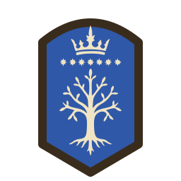

# Atlas emblems

The look of the Atlas map's Force pictures (ADR-0007): the Emblem, the
Compact marker and the Ring mark. Every Emblem is drawn to this sheet,
so that a Character's banner and a Unit's shield read as one family
beside the map's ink-on-parchment geography (docs/spec/atlas-map.md).
Devices may be traced from generated images; every committed emblem is
an SVG fitted by hand to this sheet.

## Samples

| Character: Aragorn                                       | Unit: Rohan cavalry                               |
| -------------------------------------------------------- | ------------------------------------------------- |
|  |  |

## Palette

Three tones per Emblem, and no others:

- **Ink** `#3a2c1c`: the rim and any line that parts one area from
  another. It is the map's own ink (`INK` in the Atlas renderer).
- **Field**: the Side colour, the same as the Compact marker's and the
  Dot's: Evil `#b3372c`, Good `#2f58a8`, Neutral `#3f7d3a`. An Emblem is
  authored with its field in a placeholder and tinted at draw time, so
  a Character who changes Side needs no second drawing.
- **Device** `#f0e4c4`: the charge on the field, in the map's parchment
  (`PAPER`).

The one exception is the Ring mark's gold, below. No gradients, no
texture and no shading: the parchment and its grain belong to the map,
not to the Emblem.

## Shape

The outline tells a Character from a Unit at every tier:

- A **Character** stands on a **banner** bearing a silhouette of the
  Character, standing and facing left, drawn from its Figure in the
  original where it has one. Named Characters each have their own,
  except that the lesser Nazgûl, Rohan's lesser lords and Gondor's fief
  lords share one per group; unnamed Characters ("a hobbit", "a troll")
  share one per kind; and a Character in disguise is drawn as they
  appear. The banner has straight sides, a rounded
  head, and a point at its foot. It is 28 units wide and 55 high in the
  64-unit drawing.
- A **Unit** stands on a **round shield**, 48 units across, or, for
  elite troops, a **heater shield**: a gently peaked top and a pointed
  foot, 40 units wide and 56 high. A Unit is elite where its Badge in
  the original is the heraldic shield (`finding:graphics-unit-nation-only-in-campaign-icon`).
  As on the original's Badges (`finding:graphics-unit-badge-weapons`),
  the Nation's device fills the shield, centred, and the Unit Type's
  mark crosses it at the lower right, overlapping the device: a weapon laid point up and
  to the right, overhanging the rim, or the cavalry's horse's head
  standing in the corner. A mark is rimmed in ink, so it reads over the
  device, the field and the map alike.

Banners carry no pole, crossbar, cords or ragged edges, and shields no
bosses or rivets. All Characters share one banner, and Units the two
shields, whatever their Side.

## Line weight

Each Emblem is drawn in a 64 × 64 viewBox, meant to be shown from about
24 to 64 CSS pixels tall.

- The rim is 3 units of ink, stroked on the outline with round joins.
- A mark's ink rim shows 2.5 units outside it.
- Devices are silhouettes in the device tone, drawn with the care of a
  heraldic charge: a horse is a horse at 64 pixels. Inner ink lines are
  kept to the rims; a device that needs inner detail shows it as a
  gap in the parchment, not as ink.
- A device's main masses (the horse's body and legs, the tree's trunk
  and boughs) are at least 2 units across, so its silhouette still reads
  at 24 pixels. Finer detail (leaves, mane, star points) is welcome but
  may close up when small.
- A device is traced from a generated image, not plotted by hand (see
  "Making an Emblem").

## How the renderer reads an Emblem

An Emblem is rasterised into a signed distance field with one channel
per tone, as Places' pictures are (red ink, green body): red for the
ink, green for the field, blue for the device. The renderer paints the
field in the Force's Side colour, the device in parchment and the ink
over both.

## Compact marker

The Compact marker is the Emblem's outline alone: the banner or the
shield, filled with the Side colour, with a rim of ink, and no device.
Its rim keeps the Emblem's 3-unit weight at the marker's drawn size,
but never less than 1 pixel.

## The Ring mark

The Ring-bearer's Emblem carries a small Ring mark at its top right: a
plain gold ring, `#c9a227`, with an ink rim, about a quarter of the
Emblem's width, overlapping the rim. It is the only fourth colour on
the map's Forces, drawn as its own picture over the Emblem rather than
as part of each device. The Ring-bearer's Compact marker carries the
same mark at the same proportion.

## Making an Emblem

Every Emblem is made the same way, so that they stay one family.

1. Generate a reference image with this prompt: the style paragraph,
   then one subject line.

   ```text
   A flat heraldic emblem drawn as if in pen and ink on a Tolkien-style
   parchment map. Dark brown-black ink #3a2c1c, one even line weight
   (bold enough to read at 32 px across), no hatching finer than that.
   The background is flat parchment #f0e4c4. The field is flat blue
   #2f58a8 inside an ink rim; the device is parchment negative space on
   the field. Use perfectly uniform solid colour regions, like a clean
   vector print: no paper texture, grain, lighting, shading or
   gradients. No pole, finials, cords or ragged edges. The subject is
   centred alone, with no text, border, frame or shadow. Simple, bold
   silhouette, readable as a small map marker.
   ```

   The field is always blue: the renderer tints it per Side. Subject
   lines, for example:
   - Character: "The silhouette of a hobbit, standing and facing left,
     with a walking staff, on a round-topped banner. Draw it from this
     figure:" followed by the Character's Figure in the original,
     enlarged, so the silhouette keeps its pose and outline.

   A Unit's shield is not drawn whole: the map lays its Nation's device
   and its Unit Type's mark on the round or heraldic shield. Each is
   generated alone, as "A single heraldic charge, drawn as a bold flat
   silhouette in parchment #f0e4c4 on a plain flat blue #2f58a8 square
   background that fills the whole image edge to edge", then the
   charge: "a running horse, facing left" (a device), or "a straight
   sword, lying horizontal, point to the left" (a mark). Ask for chunky
   shapes with no thin lines: a mark is drawn small.

2. Trace it with `bun run trace-emblem`, giving the shape:

   ```sh
   bun run trace-emblem aragorn.png --shape banner --out aragorn.svg
   bun run trace-emblem rohan.png --shape charge --out device-rohan.svg
   bun run trace-emblem sword.png --shape mark --out mark-infantry.svg
   bun run trace-emblem horse-head.png --shape mark --upright --out mark-cavalry.svg
   ```

3. Save it in `web/src/view/atlas/emblems/`, as `device-<nation>.svg`
   or `mark-<unit type>.svg` for a charge. Name a Character's Forces in
   `web/src/view/atlas/emblems.ts`; a Unit's Nation and Unit Type come
   from `web/src/view/atlas/unit-shields.ts`. Then run
   `bun run build-emblems` to compile the atlas the map draws from.
4. Look at the result on the map at 24 and 64 pixels. Regenerate rather than
   retouch a device that does not read; edit the SVG by hand only for
   small fixes.

Reference images are not committed.
