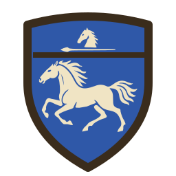

# Atlas emblems

The look of the Atlas map's Force pictures (ADR-0007): the Emblem, the
Compact marker and the Ring mark. Every Emblem is drawn to this sheet,
so that a Character's device and a Unit's shield read as one family
beside the map's ink-on-parchment geography (docs/spec/atlas-map.md).
Devices may be traced from generated images; every committed emblem is
an SVG fitted by hand to this sheet.

## Samples

| Character: Aragorn                                       | Unit: Rohan cavalry                                                  |
| -------------------------------------------------------- | -------------------------------------------------------------------- |
|  |  |

## Palette

Three tones per Emblem, and no others:

- **Ink** `#3a2c1c`: the rim and any line that parts one area from
  another. It is the map's own ink (`INK` in the Atlas renderer).
- **Field**: the Side colour, the same as the Compact marker's and the
  Dot's: Evil `#b3372c`, Good `#2f58a8`, Neutral `#3f7d3a`. An Emblem is
  authored with its field in a placeholder and tinted at draw time, so
  a Character who changes Side needs no second drawing.
- **Device** `#f0e4c4`: the charge on the field, in the map's parchment
  (`PAPER`).

The one exception is the Ring mark's gold, below. No gradients, no
texture and no shading: the parchment and its grain belong to the map,
not to the Emblem.

## Shape

The outline tells a Character from a Unit at every tier:

- A **Character** stands on a **banner**: straight sides, a rounded
  head, and a point at its foot. It is 28 units wide and 55 high in the
  64-unit drawing.
- A **Unit** stands on a **heater shield**: a gently peaked top and a
  pointed foot, 40 units wide and 56 high. A level ink line parts off its
  **chief**, the top fifth, which holds the Unit Type's mark; the
  Nation's device fills the rest.

Banners carry no pole, crossbar, cords or ragged edges, and shields no
bosses or rivets. All Characters share one banner and all Units one
shield, whatever their Side.

## Line weight

Each Emblem is drawn in a 64 × 64 viewBox, meant to be shown from about
24 to 64 CSS pixels tall.

- The rim is 3 units of ink, stroked on the outline with round joins.
- The chief line is 2 units.
- Devices are silhouettes in the device tone, drawn with the care of a
  heraldic charge: a horse is a horse at 64 pixels. Inner ink lines are
  kept to the chief line; a device that needs inner detail shows it as a
  gap in the parchment, not as ink.
- A device's main masses (the horse's body and legs, the tree's trunk
  and boughs) are at least 2 units across, so its silhouette still reads
  at 24 pixels. Finer detail (leaves, mane, star points) is welcome but
  may close up when small.
- A device is traced from a generated image, not plotted by hand (see
  "Making an Emblem").

## How the renderer reads an Emblem

An Emblem is rasterised into a signed distance field with one channel
per tone, as Places' pictures are (red ink, green body): red for the
ink, green for the field, blue for the device. The renderer paints the
field in the Force's Side colour, the device in parchment and the ink
over both.

## Compact marker

The Compact marker is the Emblem's outline alone: the banner or the
shield, filled with the Side colour, with a rim of ink, and no device.
Its rim keeps the Emblem's 3-unit weight at the marker's drawn size,
but never less than 1 pixel.

## The Ring mark

The Ring-bearer's Emblem carries a small Ring mark at its top right: a
plain gold ring, `#c9a227`, with an ink rim, about a quarter of the
Emblem's width, overlapping the rim. It is the only fourth colour on
the map's Forces, drawn as its own picture over the Emblem rather than
as part of each device. The Ring-bearer's Compact marker carries the
same mark at the same proportion.

## Making an Emblem

Every Emblem is made the same way, so that they stay one family.

1. Generate a reference image with this prompt: the style paragraph,
   then one subject line.

   ```text
   A flat heraldic emblem drawn as if in pen and ink on a Tolkien-style
   parchment map. Dark brown-black ink #3a2c1c, one even line weight
   (bold enough to read at 32 px across), no hatching finer than that.
   The background is flat parchment #f0e4c4. The field is flat blue
   #2f58a8 inside an ink rim; the device is parchment negative space on
   the field. Use perfectly uniform solid colour regions, like a clean
   vector print: no paper texture, grain, lighting, shading or
   gradients. No pole, finials, cords or ragged edges. The subject is
   centred alone, with no text, border, frame or shadow. Simple, bold
   silhouette, readable as a small map marker.
   ```

   The field is always blue: the renderer tints it per Side. Subject
   lines for the samples:
   - Character: "Aragorn's device, the White Tree of Gondor with exactly
     seven stars in a row beneath a crown, on a round-topped banner.
     Crown at top, stars beneath it, tree below the stars."
   - Unit: "A heater shield bearing a running horse (Rohan), with a
     small cavalry mark (a horse-head or lance) in the shield's chief."

2. Trace it with `bun run trace-emblem`, giving the shape and, for
   a Unit, the crops that part the chief's mark from the Nation's
   device, in the reference's pixels. The samples were made with:

   ```sh
   bun run trace-emblem aragorn.png --shape banner --out aragorn.svg
   bun run trace-emblem rohan.png --shape shield \
     --crop 1254x620+0+360 --mark-crop 1254x230+0+120 \
     --out rohan-cavalry.svg
   ```

3. Save it in `web/src/view/atlas/emblems/`, name the Forces it is
   drawn for in `web/src/view/atlas/emblems.ts`, and run
   `bun run build-emblems` to compile the atlas the map draws from.
4. Look at the result on the map at 24 and 64 pixels. Regenerate rather than
   retouch a device that does not read; edit the SVG by hand only for
   small fixes.

Reference images are not committed.
